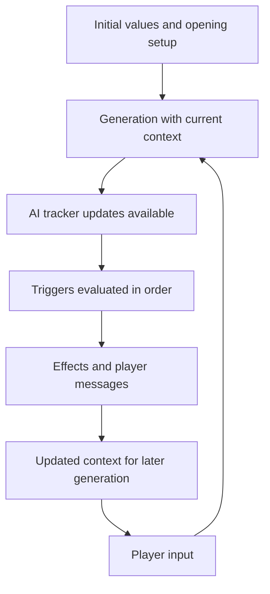

# IW capability reference

Use Evidence.md for the shared evidence legend and compatibility baseline. Known-Limits.md lists the remaining platform boundaries.

## Turn lifecycle [RUNTIME]

An authoring model of the established boundaries:

- Start+Mid+repeat triggers can execute in a pre-opening setup pass and again during the first normal turn. Messages from the setup pass appear before the opening background. Trigger history records setup-pass firings as turn 0; the value of $game.turn_number during setup is not established. Guard initialization and counters according to the intended behavior.
- During normal turns, generated tracker changes are available to trigger conditions. Ordered triggers can see earlier trigger writes. The practical order to author is the `triggerEvents` array; preserve it and verify editor reorder/export behavior if changing order through the UI.
- Scenario judgments must be available for their trigger checks, but their exact stage relative to Evaluation, narration and tracker updates is not mapped.
- Messages belong to their effects; they need not be a single final batch after all triggers. Choice/input effects can suspend for a player answer. Correctly bound single-answer forms update immediately and permit later triggers to read the answer in the same turn.
- Guidance and block changes do not rewrite already-generated narration. Updates supply context for subsequent generation. When guidance effects conflict, the first tends to win; generate one coherent directive instead.
- Summary generation is a separate context-maintenance process. Compression follows a six-turn cadence beginning at turn eight (user-confirmed); its ordering relative to other turn stages is not established.

Timing flags (Start, Mid Game, repeat), prerequisites and blockers are covered in [Triggers.md](Triggers.md).

## Skills and player characters

Root `skills` is a list of display names. Each possibleCharacters entry has a `skills` object keyed by those names, with integer levels. Define focused skills with distinct jobs; overlapping names can make the evaluator's choice ambiguous. Example: Observation, Persuasion and Engineering. PC `description` establishes identity, abilities and context; it is not just selection-page decoration. `charSelectText` introduces the available choices to the player. The allowChangeCharacter* flags control which parts players may customize.

Keep at least one skill. For generated JSON, use `hideSkillSystem: false` when Skills should be visible; an unchecked editor option may omit the field, which is normal and needs no repair. `hideSkillSystem` hides the skill system's presentation; it is not evidence that all evaluation of abilities is disabled. A neutral generic skill is appropriate when the story does not need custom skill distinctions.

PawScript exposes `$player.skills`, `$player.skills_and_levels`, `$game.skill_map`, `$game.skill_list`, `$game.skill_example`, `$game.difficulty_list` and `$game.difficulty_example`. The skill map connects runtime slugs to display names. The documented difficulty names are Trivial, Easy, Medium, Hard and Legendary; use the supplied runtime list when rendering prompts rather than inventing numerical modifiers. Official documentation describes a default level of 3 for skills not raised. Explicitly initialize authored PC levels rather than depending on that fallback. Do not invent slug normalization for punctuation-heavy names. [PawScript reference](https://infiniteworlds.app/pawscript-reference)

Native `effectChangePCSkill` uses the declared display name. `amount` is an integer magnitude; `increase: true` increases toward `minmax` as an upper cap; false decreases toward it as a lower bound. Two successive triggers increasing a level initially 2 by 2 up to 4, then by 1 up to 4, finish at 4. This differs from adding both increments and applying no intermediate cap. The included probe also checks decreases and boundary cases.

Skill levels are fixed integers from 0 through 5. The AI selects the available skill whose name best matches the attempted action; name skills so their scope is clear.

`Default-Evaluation.txt` contains the editor-provided baseline verbatim. It asks for a brief assessment, skill/difficulty and DENIED, SUCCESS, FAILURE or PARTIAL_SUCCESS. Trivial uncomplicated actions succeed; impossible assertions can be denied. Otherwise proficiency, difficulty, character history, instructions and common sense inform the judgment. Partial success covers incomplete achievement, failure with a silver lining, or success with drawbacks. No numerical success-probability table is established.

Use actual numeric skill values for mechanical checks. Generated skill labels and Evaluation descriptions can disagree with those values; a prose description is not authoritative numeric state.

The baseline was captured from the custom-Evaluation editor's prefilled text. The test used that text explicitly. The Script Library's Storymaster override defines its own caveat labels; keep it distinct from the baseline.

## NPC cards and keyword blocks

NPC field/activation guidance is [DOCUMENTED]; the stated plain-word keyword matching and retention are [RUNTIME].

| NPC field | Authoring purpose |
| --- | --- |
| id | Stable card identity |
| name | Canonical character name |
| names | Recognition names/aliases; use distinctive forms |
| one_liner | Compact identity/role summary; put essential identity here |
| detail | Fuller personality, motives, history, behavior and relationships |
| appearance | Narrative appearance description |
| location | Optional start location, activation cue; not required if named in instructions. Not movement lock |
| secret_info | Hidden character facts; instructions still govern who knows them |
| img_appearance / img_clothing | Visual identity and clothing guidance for image handling |
| positionInList | Ordering metadata; preserve existing values; use sequential integers for new lists |

IW permits a character among both player choices and Other Characters under the same name. The selected player can retrieve information from that entry, but internal identity merging/exclusion is not visible. Unchosen player options are not NPCs unless also added as Other Characters. Author the intended relationship explicitly where it matters. PC/NPC conversion is available in Data mode: preserve the source and map relevant fields into the destination type, rather than relabeling the native object.

Only Name is required in the NPC editor. Storytelling and image information have independent optional sections; do not infer their serialized enable flags from the UI alone. The storytelling help states that the brief summary is the only character information available to the storyteller until the turn after the character or their location is first mentioned. Characters can activate by name with no location. Put essential information in one_liner and repeat it in detail. Detail retrieval is unreliable: a name-only mention did not surface an authored hobby on two turns, the narrator invented one, and history then repeated the invention. Put facts that must surface in the Summary or always-on text, and correct a wrong invented detail early by editing the turn. The narrator can also introduce named NPCs into an opening that says the player is alone. Location is a short starting location (editor asks for no more than two words). Full list of names accepts comma-separated variants in the editor; preserve the export's names representation. Image appearance/clothing guide the image AI and can be inspected using the wrench under a character image. Mentioning footwear can encourage full-body framing, per editor help.

NPC activation and static character context are not exposed in World Debug. The editor help supplies the activation guidance above; debug cannot verify a card's activation window. Secret fields are not a guaranteed protection against narrative leaks.

Keyword entries have id, name, keywords (string array), and content. Choose distinct phrases and relevant aliases; broad terms such as "man" can activate irrelevant lore. They load through mention/context matching, rather than deterministic location checks. Matching is case-insensitive and whole-word: quartzbadger and QUARTZBADGER match; prequartzbadgerpost does not. A match keeps the block active on the matching turn and three additional turns: a turn-3 match remains active on turn 6 and is inactive on turn 7 unless another match occurs. These input cases and retention were checked through debug. Surrounding punctuation and alternate authored keywords can match; embedded substrings and a simple plural did not. Completed narration and Secret Info can contribute to later activation. The complete tokenizer, arbitrary multiword behavior and full set of scanned fields remain unresolved. Do not invent matching operators or regex syntax. A short persistent rule can be always-on while its detailed lore remains keyword-triggered.

## Specialist requests and runtime outputs

| Export field | Intended responsibility | Empty-field policy |
| --- | --- | --- |
| evaluationRequest | Interpreting action feasibility, skills/difficulty and outcome reasoning | Retain empty to use native behavior when no override is needed; Default-Evaluation.txt contains the editor-provided baseline |
| descriptionRequest | Narration, viewpoint, presentation and prose rules | Use native behavior or supply a focused override |
| summaryRequest | Instructions for persistent summaries | Preserve facts important to this world's continuity; cadence in [Trackers.md](Trackers.md) |
| videoPromptInstructions | Separate video planning/image-position/prompt instructions | Preserve default/empty configuration unless video is part of the requested design |

Editor help says Evaluation outputs guide AI thinking; SUCCESS/FAILURE are not special control tokens. These are instructions, not executable hooks. Writing SUCCESS in Evaluation does not itself fire a custom trigger. Replacing a default request with a large custom framework can change its responsibilities; inspect dependencies rather than copying only one field.

To shorten narration, append to authorStyle: "The outcomeDescription must be at most 2 short paragraphs and no more than 90 words. This is a maximum, not a target, and overrides any other length instruction." Output lands near the number, sometimes 10–20% over. The same text in descriptionRequest is weaker. Lengthening is not established.

Runtime names referenced by the sample library:

| Names | Use / limit |
| --- | --- |
| evaluation | Generated reasoning/result assessment; not a guaranteed machine-readable API |
| playerAction | Current player input context |
| outcomeDescription | Main narration |
| whereWhen / whereWhenAfter | Place/time context before/after the narrated scene; formatting guidance can target whereWhen |
| elapsedTime | Generated elapsed-time information; exact type/units not established by the sample |
| secretInfo | Generated secrets/planning, not a privileged dump of runtime memory |
| option1_text / option2_text / option3_text | Suggested player actions |
| illustrSubject / illustrIsCharacter | Illustration subject/character distinction |
| illustrAppearance / illustrClothes / illustrExpressionPosition / illustrSetting | Visual descriptors |
| stateVariablesUpdates | Tracker-update output concept; do not hand-invent its native wire format |

This is a useful inventory from the supplied library, not a complete public output schema. Fields mentioned in instructions are not automatically template variables, writable script roots, or valid new export keys. Model instructions can influence output but cannot create engine capabilities.

## Template interpolation [RUNTIME]

Use `<<expression>>` inside supported text templates; use bare expressions in `triggerOnPawScript` and bare code in Run Script. Standard variable references use `$`, while older templates such as `<<skills_and_levels>>` appear in existing worlds. Prefer the explicit documented `$player.skills_and_levels` form in new content. [Expressions guide](https://infiniteworlds.app/pawscript-expressions-guide)

| Surface | Authoring expectation |
| --- | --- |
| Main/active instruction text | Values are substituted when prepared for AI context; conditional expressions can select current guidance |
| Show Message / native effect text | Text is resolved for that effect; inspect the exact output if timing matters |
| Initial values / PC script-generated options | Initialization context, not a persistent live binding |
| Native block-modification content | Ordinary `<<...>>` expressions are resolved when the effect installs the text. In the tested block, coins=13 stayed 13 on later turns while Coins advanced to 14 and 15. Deferred `<<=...=>>` references in the installed text remain live |
| NPC, keyword, image, specialist or metadata fields | Do not infer identical evaluation timing for every string field; use the template probe before relying on a novel surface |

An expression authored directly in a permanent block can select current text without a trigger whose only job is switching it. In contrast, ordinary `<<...>>` expressions passed through a block-modification effect become a snapshot in the tested path. To keep a value live, write it as a deferred `<<=...=>>` reference in the installed text (worked example in [PawScript.md](PawScript.md)), keep the expression in a separate permanent block, or refresh the block when the source changes. Nested expression strings are not evaluated recursively. Selecting text this way does not save tokens automatically: the selected content still enters context. Random expressions may reevaluate independently; store a shared roll in a tracker when several outputs must agree. Runtime output names and video-context names do not become globally available merely because a sample uses them.

## Endings

Native victoryCondition/defeatCondition can be null (disabled), or `{condition, text, alreadyFired}`. The supplied native sample uses **natural-language condition text**, not a mandatory PawScript expression. State the accomplishment or failure precisely. `text` is its player-facing ending message. Initialize `alreadyFired: false` for a fresh world; preserve it when editing a live export unless deliberately resetting ending state. alreadyFired can remain false after an ending and continuation. Do not read this serialized field as a reliable record of runtime ending execution. Use your own tracker if that history is needed. Other ending timing/repeat behavior is not inferred from this field.

For an exact state threshold, a PawScript condition plus Show Message and Ends Game is an alternative. `effectEndsGame.data` controls whether the player may choose to continue; true permits continuation. It is not an enable flag. With true, Continue game and confirmation restore actions; false removes continuation and action fields while history/regeneration remain. This alternative does not prove that the built-in natural-language ending checker shares its timing.

Native value and input payloads are documented in Schema.md.

## Formats, editor controls and content settings

`formatSchema` uses the library's readable structured notation: text/number describe leaf values, `field?: text` marks an optional key, and `...:` permits open/additional content. It is not JSON Schema. `formatExample` shows an intended value; examples should not become starting facts. Do not claim it validates arbitrary schemas; its full grammar is unknown.

`xml` is an available tracker dataType. Its existence does not establish XPath support or the same path/mutation semantics as YAML. Use it for a requested XML representation; obtain a small export/runtime check for structured XML manipulation.

`advancedLogic` accompanies the trigger editor's advanced condition setup; use true for authored nested logic groups and preserve existing values. The logic node tree expresses the actual predicates. `showPawScriptButtons` is an editor UI flag, not permission for script execution. Its exact UI presentation is not mechanically important here.

Enable Storyteller mode through Menu > Settings > Storyteller Mode. It is required for secret/hidden data inspection/export and debug access. Debug is the squashed bug icon beside the tracked-items icon. It provides the current turn's active instruction blocks including trigger updates; names of triggers fired this turn; all-trigger history with first/last turn and counts where applicable; model thinking when available; Evaluation; and PawScript conditions, execution results, output, warnings and errors. Warnings/errors include automatic tracker format repair and failed format/path updates.

Each PawScript entry's Open in Sandbox opens an editable script/expression plus complete tracker data for that turn for local test runs. A sandbox result tests the supplied state/code, not the entire narrative pipeline. The active-block view includes post-trigger updates, so it is not necessarily an exact capture of the context used by the already-generated narration.

Story exports support a chosen turn range, optional background, character, secret information, trackers and hidden trackers; text or PDF with optional images. Select hidden trackers explicitly when diagnostics require them.

`mature` and `nsfw` are content-setting booleans. Select them deliberately for the intended audience and content, and provide contentWarnings where appropriate. They do not define a precise prose policy or guarantee permission, discoverability, model selection or filter behavior. Write the actual creative boundaries in AI-facing instructions.

## Images, video and model-specific blocks

The current image-style editor is a reusable style editor with Name, Model and prompt wrappers. With separate character/scenery prompts enabled, Characters—start/end and Scenery—start/end add text before/after their respective image prompts. With it disabled, Start/End apply to every image. The corresponding world export fields are imageStyleCharacterPre/Post and imageStyleNonCharacterPre/Post; shared Start/End are exported by duplicating the values into both character and non-character Pre/Post fields. No extra switch is needed to represent the shared prompt text in these exports. The imageStyle value is a generated bespoke identifier; preserve it rather than deriving it from the prompt text. This world export is not a complete standalone reusable-style library export.

The old illustrationStyle*LowPriority/HighPriority fields still occur in exports, but there are no matching current controls. Preserve them in existing worlds; do not present them as active current editor controls or invent their precedence. Manticore is the current recommended model in editor help; its preset text includes IWBeautiful/IWUpscaleFace macros whose mechanism is undocumented. The selected style can be overridden by the player. A cover prompt is separate from these wrappers. Current Pre/Post wrappers influenced character/scenery styles, but exact prompt assembly and universal precedence remain unknown.

Dedicated Other Character image appearance/clothing can populate image details independently of narrative appearance. Edits affect generated images and can be reversed; alias-related clothing drift is possible.

PC portraitPromptDetails holds four strings: illustrAppearance, illustrClothes, illustrExpressionPosition and illustrSetting. The cookbook supplies an example. Image generation/upload produces asset references; those references belong in portrait/preview fields. Cover Image script produces a **prompt**, not an asset URL. Use it in the image workflow, then select/upload the result as the world preview and export the resulting metadata. Do not paste a prose prompt into previewImage.

Resolve bracketed image-style slots as deliberate choices. Remove unselected choices and incidental sexualized defaults unless they match the requested audience/style. Preserve neutral medium, composition, lighting and identity guidance. Avoid mixing contradictory medium/style lists simply because the source offers them.

videoPromptInstructions has videoPlan, videoImagePosition and videoPrompt strings. The library uses videoPlan to choose a beat, videoImagePosition to choose start/end anchoring, and videoPrompt to describe the clip. Its `$videoDuration` and `$videoStyle` references are video-context dependencies, not declared trackers in that library and not documented global PawScript roots. Confirm their availability through the video editor/debug context before adopting the sample unchanged. No video-enabled runnable example is claimed until that capture exists.

Enable model selection per world under Show optional features > Misc advanced features > Enable AI-specific instruction blocks. Selected block models serialize in selectedAIProfiles. All-model blocks remain active while selected-model blocks follow the active model. Current-AI-Profiles.json lists each storyteller model's ID, underlying real-world model, isCurrent flag and typical credits per turn, including retired models (dated October 26, 2026; the community wiki is the live source). It is not a validator enum: accept arbitrary historical IDs and preserve imported selections.

Disabling this editor option removes selectedAIProfiles from exported blocks and hides their controls. The still-open editor temporarily remembers choices if re-enabled, but that memory does not survive closing it. Do not treat disabling as a durable reversible runtime switch or promise that exporting while disabled preserves selections. A block name alone does not select models. Whether the choices are fetched live is an inference; their exact source is unnecessary for authoring.

## Current-game editing and debug boundaries
Live copies and what editing them changes are covered in [Import-Integrity.md](Import-Integrity.md). Debug shows keyword-block active/inactive state and its keywords, but not the matched keyword, activation turn or remaining retention. It does not expose NPC activation or static character information. A live-world JSON export can retain the tracker's initialValue despite a successful runtime change; inspect current tracker data for current values.

For temporary instruction-block installation with a retained result, see [on-demand generation](Recipes.md#dynamic-content). Generation happens after installation; cleanup checks the request identity and completion rather than assuming the next turn succeeded. This pattern is useful only when omitted instruction context justifies result-storage and update costs.

[Editor-UI](Editor-UI.md) contains exact workflow distinctions; [Verified-Behavior](Verified-Behavior.md) consolidates tested results.

---

END OF DOCUMENT: reference/Capabilities.md
