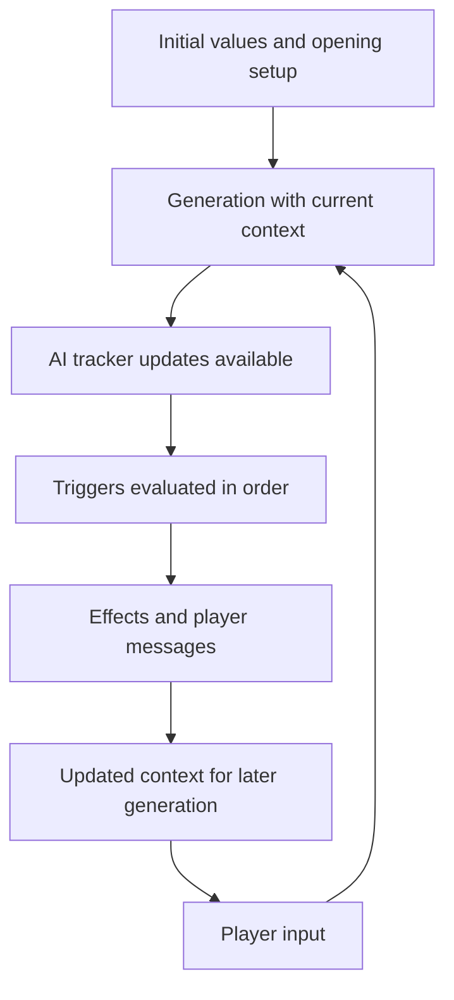

# Turn lifecycle, templates and endings

How a turn is processed, when `<<...>>` templates are evaluated, how the specialist requests divide the work, and how endings are defined. Evidence labels and the compatibility baseline are in [Verified-Behavior.md](Verified-Behavior.md); what remains unresolved is listed in [Notable-Findings.md](Notable-Findings.md#still-unknown).

## Turn lifecycle [RUNTIME]

- Start+Mid+repeat triggers execute in a pre-opening setup pass and again during the first normal turn. Messages from the setup pass appear before the opening background. Trigger history records setup-pass firings as turn 0; `$game.turn_number` during setup is unknown. Guard initialization and counters accordingly.
- During normal turns, the AI's tracker updates are available to trigger conditions, and ordered triggers see earlier triggers' writes. Execution order is the `triggerEvents` array.
- Scenario judgments are available for their trigger checks; their exact stage relative to Evaluation, narration and tracker updates is not mapped.
- Messages belong to their effects and appear as each effect runs. Choice/input effects suspend for a player answer; a correctly bound single-answer form updates its tracker immediately, and later triggers read the answer in the same turn.
- Guidance and block changes do not rewrite narration that has already been generated; they supply context for the next generation. When guidance effects conflict, the first tends to win, so generate one coherent directive.
- Summary compression runs after turn 8 and every six turns after that, leaving the 2–7 most recent turns uncompressed; its ordering relative to other turn stages is unknown.

Timing flags (Start, Mid Game, repeat), prerequisites and blockers are covered in [Triggers.md](Triggers.md).

## Template interpolation [RUNTIME]

Use `<<expression>>` inside supported text templates; use bare expressions in `triggerOnPawScript` and bare code in Run Script. Variable references use `$`; older templates such as `<<skills_and_levels>>` appear in existing worlds, and `$player.skills_and_levels` is the form for new content. [Expressions guide](https://infiniteworlds.app/pawscript-expressions-guide)

| Surface | When the expression is evaluated |
| --- | --- |
| Main/active instruction text | When the text is prepared for AI context, every turn; conditional expressions select current guidance |
| Show Message / native effect text | When that effect runs |
| Initial values / PC script-generated options | At initialization only; not a live binding |
| Native block-modification content | When the effect installs the text, and never again: `coins=13` stayed 13 while Coins advanced to 14 and 15. A deferred `<=...=>` reference in the installed text stays live |
| A tracker's own update instructions | Every turn, before the AI writes the tracker |
| NPC, keyword, image, specialist or metadata fields | Not tested; use ../examples/probe-template-timing.json before relying on a new field |

An expression authored directly in a permanent block selects current text without a switching trigger. Ordinary `<<...>>` expressions passed through a block-modification effect become a snapshot; to keep a value live, write a deferred `<=...=>` reference in the installed text (worked example in [PawScript.md](PawScript.md)), keep the expression in a separate permanent block, or refresh the block when the source changes. Nested expression strings are not evaluated recursively. Selected text still enters context, so selection does not save tokens by itself. Independent random expressions give independent results; store a shared roll in a tracker when several outputs must agree. For temporary instruction-block installation with a retained result, see [on-demand generation](Recipes.md#dynamic-content).

## Specialist requests and runtime outputs

| Export field | Responsibility | When empty |
| --- | --- | --- |
| evaluationRequest | Interpreting action feasibility, skills/difficulty and outcome reasoning | IW uses its built-in Evaluation, reproduced verbatim in Default-Evaluation.txt; leave empty unless a custom Evaluation is part of the design ([Characters.md](Characters.md#evaluation)) |
| descriptionRequest | Narration, viewpoint, presentation and prose rules | IW's default asks for several paragraphs |
| summaryRequest | What the persistent summaries must retain | IW's default summary; name the facts important to this world's continuity ([Trackers.md](Trackers.md#memory-continuity-and-context-cost)) |
| videoPromptInstructions | Video planning, image position and prompt | IW's defaults; leave unless video is part of the design ([Images-and-Models.md](Images-and-Models.md#video)) |

Evaluation outputs such as SUCCESS and FAILURE are generated text that guides the AI's thinking; they are not control tokens and do not fire triggers. Replacing a default request with a large custom framework changes its responsibilities; carry over the framework's dependencies rather than one field.

To shorten narration, append to authorStyle: "The outcomeDescription must be at most 2 short paragraphs and no more than 90 words. This is a maximum, not a target, and overrides any other length instruction." Output lands near the number, sometimes 10–20% over. The same text in descriptionRequest is weaker. No wording has been found that reliably lengthens narration. Narration renders ordinary Markdown; raw HTML renders as literal text, so test headers or special formatting in their display context.

Runtime output names that the sample library refers to in instructions:

| Names | Meaning |
| --- | --- |
| evaluation | The generated assessment of the attempted action |
| playerAction | The current player input |
| outcomeDescription | The main narration |
| whereWhen / whereWhenAfter | Place/time context before/after the narrated scene; formatting guidance can target whereWhen |
| elapsedTime | Generated elapsed-time information; type and units unspecified |
| secretInfo | Generated secrets, planning and off-screen developments |
| option1_text / option2_text / option3_text | The suggested player actions |
| illustrSubject / illustrIsCharacter | Illustration subject and character/scenery distinction |
| illustrAppearance / illustrClothes / illustrExpressionPosition / illustrSetting | Visual descriptors |
| stateVariablesUpdates | The AI's tracker-update output |

These are names for parts of the generated output. They can be described in instructions and specialist requests, but they are not template variables, script roots or root export fields, and their contents are generated text rather than engine memory. secretInfo legitimately holds secrets, planning and off-screen developments, and the Storymaster family structures it explicitly; impose an empty-secretInfo policy or a reset system only when a world's design asks for it.

## Endings

Native victoryCondition/defeatCondition is null (disabled) or `{condition, text, alreadyFired}`. `condition` is natural-language text stating the accomplishment or failure precisely, not a PawScript expression; `text` is the player-facing ending message. Initialize `alreadyFired: false` for a fresh world and preserve it when editing a live export unless deliberately resetting ending state. The field can stay false after an ending and continuation, so use your own tracker if ending history is needed.

For an exact state threshold, use a PawScript condition plus Show Message and Ends Game. `effectEndsGame.data` says whether the player may continue: true offers Continue game, which restores actions after confirmation at no charge; false removes continuation and action controls while history and regeneration remain. The built-in natural-language ending checker runs on its own timing, which is unknown.

## Current-game editing and debug boundaries

Live copies and what editing them changes are covered in [Editor-UI.md](Editor-UI.md#import-export-and-preserving-work). Debug shows keyword-block active/inactive state and its keywords, but not the matched keyword, activation turn or remaining retention, and nothing about NPC activation or static character information. A live-world JSON export can retain a tracker's initialValue after a runtime change; read current tracker data for current values.

[Editor-UI](Editor-UI.md) contains the workflow detail; [Verified-Behavior](Verified-Behavior.md) consolidates the tested results.

---

END OF DOCUMENT: reference/Runtime.md
