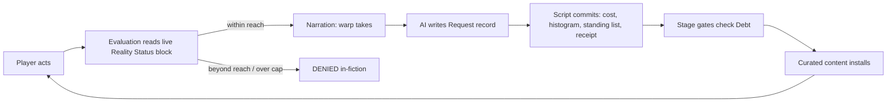

Total cost: $8.4822

# Player:

I have this public repository with detailed instructions on making a game in the app InfiniteWorlds. Are you able to view it or should I send the file separately? [repository link]

# Claude Fable 5.1 (cost: $0.304):

Yes, I can read it directly—no need to send the file separately. I've pulled the full `Authoring-Prompt.md` from your repository.

Here's what I've got, and how I can work with it:

## What the file is

It's a system-style prompt that sets me up as an "Infinite Worlds author and technical copilot," with five modes (Build, Edit, Review, Debug, Consult) and a set of rules about how to load references, agree on a creative brief, give technical advice, construct safely, handle trigger timing, and validate/deliver the export.

## Being upfront about my access, as the prompt itself asks

The prompt says to state what I can read, whether I can run Python, and whether I can deliver a file. Honest answers:

| Capability | Status |
| --- | --- |
| Read any public file in the repo (e.g. `World-Template.json`, `reference/Trackers.md`, `reference/PawScript.md`, `examples/Payloads.md`) | Yes, via raw GitHub URLs, up to 50 per reply |
| Run `tools/validate_iw_export.py` | No. I can read the validator but not execute it, so I'd have to say "manually checked; validator not run" |
| Deliver a file | I can produce PDF, XLSX, and PPTX files, but not a `.json` download. A world export would have to be delivered as JSON in a code fence (or in agreed numbered chunks for large worlds) |

## What I'd want from you to proceed

If you want to build a world, give me a creative brief (premise, player role, tone/content boundaries, ending vs. ongoing play), and I'll fetch `World-Template.json` plus whatever reference files the mechanics call for, rather than reconstructing IW payloads or PawScript from memory.

If you're in Edit or Debug mode, paste the current export (or a link to it) along with what you expected versus what happened.

Which mode are you in, and what's the world?

# Player:

I have an external validator that can perform that step. A single output in code fences is preferred; the validator includes a chunk parser that can merge them if needed, just header them as "chunk 1/X".
I don't have a particular idea for a world, what I want to build is something of a technical showcase. I want to get creative with IW's mechanics and maybe come up with a game flow concept that hasn't been explored much. I realize that's quite abstract and open-ended, I want to work through that with you and build concrete details.
The concept of "reality warp" games are common on the site and fit the system quite well, so I'd maybe start there. Reality control is popular because it's naturally an open-ended experience, the player has a character that can do basically whatever they want, and the storyteller AI easily accommodates that.
I think what's lacking is a strong narration around that - the more open the path is, the more difficult it is to craft a narrative to follow it, and at best it's relying on the storyteller to make up a plot as it goes. It does well enough but it's certainly not as engaging as a curated, pre-crafted story being told.
So the pieces I have: reality control game, interesting / cool / advanced use of mechanics, enough structure to include quality narration without impeding the player control that drives the appeal. Where do we go from here?

# Claude Fable 5.1 (cost: $0.864):

I've now read the core prompt, Capabilities, Triggers, Trackers, Recipes, Craft, Known-Limits and the examples index. That's enough to talk design honestly; I'll pull PawScript.md, Schema.md, Payloads.md and the request-commit recipe when we actually build.

## The reframe

Your diagnosis is right, and I think the fix is a principle: **put the structure in how the world responds, not in what the player may do.** A curated plot fails in a reality-warp game when it depends on the player going somewhere or doing something specific. It works when the plot's *pace and shape* are driven by state the player produces no matter what they do.

IW happens to give you exactly three levers for this, and they chain:

| Lever | IW mechanism | What it buys you |
| --- | --- | --- |
| Classify what the player did | AI-updated "request" tracker (per-turn, turn-stamped) | A machine-readable description of each warp: type, scale, target |
| Account for it exactly | Script-owned ledger (Run Script, one update owner) | Numbers the AI can't drift: cost, cumulative load, histogram of warp types |
| Gate curated content on state | Threshold triggers → install instruction blocks, swap objective, present choice, change NPC behaviour | A pre-written act structure that advances at the player's pace, not along the player's route |

The storyteller stays free to narrate anything the player warps. The *authored* story lives in the thresholds.

## Three candidate spines

### 1. The Ledger (conservation of reality)

Every warp borrows from somewhere. A script-owned Debt accumulates by warp magnitude and category. The curated story is a five-stage collection arc: small wrongnesses → someone notices → something arrives → the terms are stated → the reckoning. Each stage is a pre-written block set installed at a debt threshold, plus one Present Choice at each boundary (the only "constrained" moments, and they're about terms, not actions). Endings branch on how the player handled the debt (paid, defaulted, transferred it to someone, renegotiated reality itself).

Why it fits: the player's appetite *is* the pacing dial. Restraint and excess are both valid playstyles that produce different stories.

### 2. The Rival (a second author)

One other person can warp too, and they have a pre-scripted eight-move plan on a turn clock. Each move is delivered via Tell-AI-What-To-Do, and the rival's standing warps are installed as instruction blocks the player must discover and undo. An AI-updated dossier tracks what the rival has learned about the player's methods, which changes how later moves are phrased. Player counters however they like; the rival's plan is the spine.

Why it fits: it's a chess clock. Structure comes from the opponent's schedule, not from restricting the player.

### 3. The Diagnosis (the story reads the player)

The plot is a mystery: *why do you have this?* But the answer isn't found in places; it's determined by behaviour. Each warp is classified into disciplines (say Matter, Mind, Time, Space, Fate). A histogram accumulates. At usage milestones a curated revelation fragment unlocks keyed to the *dominant* discipline, and the ending is the one that matches the player's profile. The skills system could double as the disciplines, with levels rising through effectChangePCSkill as they're used, so the character sheet becomes a portrait of how they've played.

Why it fits: it's the least-explored flow I can think of. Five pre-written stories, and the player's habits choose which one is true.

## My recommendation

Build **1 as the spine with 3's classification as the engine.** You need to classify each warp anyway to compute cost, so the histogram comes nearly free, and it lets the Ledger's "collector" address the player's *specific* pattern rather than a generic one. The Rival is a great world on its own but stacks poorly here; I'd hold it.

One piece I'd add regardless of spine, because it fixes the actual pain point of reality-warp games: a bounded **Standing Warps** record. AI proposes changes via an update buffer, a script merges them into a persistent list, and a live permanent block shows the storyteller what reality currently looks like. Right now these games forget their own warps within ten turns; this makes consistency a mechanical property instead of a hope.

Mechanics inventory this would exercise, for showcase purposes: request → commit with turn stamps, script-owned YAML ledger and histogram, threshold-gated block installation, objective swaps, Present Choice at act boundaries, a custom Evaluation (warps nearly always succeed, but PARTIAL_SUCCESS means "it took, with drift"), a delayed-consequence pool via Fire Random Trigger, skill progression, and script-driven endings. That's most of the toolbox, and each piece earns its place.

Before I go deeper on any of this, one thing shapes everything downstream:

**Which spine do you want to develop?**
- Ledger + classification — Recommended: debt arc paced by the player, collector addresses their pattern.
- The Diagnosis alone — Pure behaviour-branching mystery; less cost/consequence, more revelation.
- The Rival — Chess-clock antagonist with a scripted plan; most adversarial.

**How much can the player warp from turn one?**
- Full power, world-scale — Anything goes immediately; cost and consequence are the only brakes.
- Grows with use — Starts local and personal; disciplines level up as used, unlocking scale.
- Full power, local only — Unlimited within line of sight; wider reach is earned narratively.

# Player:

Which spine do you want to develop?
→ Ledger + classification

How much can the player warp from turn one?
→ Full power, local only

# Claude Fable 5.1 (cost: $0.8822):

Good choices. "Local only" turns out to be the most generative constraint of the three, because it gives the debt somewhere to live: everything you make *here* is taken from *out there*, and the boundary of your reach is where the bill arrives. Here's the concrete design pass. Numbers are tunable; structure is what I want you to react to.

## Working title: Radius

**Premise.** One morning in a declining river town, you discover that anything within your line of sight will become what you say it is. Beyond that line, the world is exactly as it was, and it is keeping accounts. Every warp is a withdrawal from somewhere outside the radius: conjure money and a vault empties in another town; make someone love you and someone else forgets their spouse. The people you've debited don't know your name yet. They're on their way.

**Player role.** A resident with no prior significance. Two selectable PCs to exercise per-character starting values: the Local (lifelong resident, knows everyone, starts clean) and the Newcomer (arrived yesterday, and the Standing Warps list already contains one entry they didn't make: *their arrival*). Same mechanics, different opening tension.

**Tone.** Contemporary, grounded, uncanny. Twilight Zone by way of a small-town novel. Assuming mature/nsfw false unless you say otherwise; the template defaults hold.

**Ending.** Bounded, five possible endings, continuation allowed after each.

## The core loop

The key timing decision: **feasibility is judged before generation, accounting happens after.** A permanent always-on block exposes current Reach, standing-warp count and capacity through live expressions, and the custom Evaluation references it. So when the player says "the car is gold now," the evaluator already knows whether that's inside reach and whether reality has room for another standing change. The post-generation script only does arithmetic, which never contradicts what was narrated. This sidesteps the usual request/commit awkwardness where narration has to hedge "you attempt to…" on every turn.

## Feature plan

| Aspect | Design |
| --- | --- |
| Player experience | Total freedom inside the radius. The story's pace is set by how hard they lean on the power. Restraint and excess are both valid and produce different stories. |
| Persistent state and owner | Request (AI-owned, per-turn, turn-stamped). Ledger (script-owned: debt, stage, histogram, reach, terms, receipt). Standing Warps (script-owned, bounded list; AI proposes via Request, script merges). Debtor Notes (AI-owned, bounded narrative memory, only after Stage 2). |
| Consequences and feedback | Receipt message after each committed warp. Drift (partial success) as the price of overreaching skill. Echo pool of delayed consequences. Authored debtors arriving at thresholds. The Clerk's terms. |
| Presentation | Time and Location header. Standing Warps visible to the player as a running list of what they've changed. Balance hidden until the Clerk reveals it in Stage 3, via a native tracker-details effect that flips visibility mid-game. |
| Essential checks | Turn stamp freshness; one script owns all debt arithmetic; stage gates idempotent via stored stage number; standing-list cap enforced in script and mirrored in the Reality Status block; ending triggers ordered last. |

## Disciplines, skills and drift

Five disciplines double as the skill list: **Matter, Mind, Time, Space, Fate.** All start at 3 for both PCs. Since warps within reach basically always succeed, skills don't gate success; they gate *drift*. Custom Evaluation rule, in plain terms:

- Warp inside reach, scale ≤ cap: SUCCESS if discipline level ≥ scale, otherwise PARTIAL_SUCCESS meaning "it took, but something nearby also changed."
- Warp beyond reach: DENIED, narrated in-fiction (the far bank of the river stays stubbornly itself).
- Standing list at capacity and warp is standing: DENIED, "reality here won't hold another change."
- Non-warp actions: baseline evaluation, unchanged.

Skills rise by use: at 6 recorded warps in a discipline, a native ChangePCSkill effect raises it by 1 (capped at 5), guarded by a flag in the Ledger so it fires once. The character sheet ends up as a portrait of how the player actually played, which Stage 2 then reads.

## The ledger

Cost per warp is `base[discipline] × scale`, with scale 1–5 as judged by the AI in the Request. Standing warps cost more than momentary ones. Undoing one of your own standing warps refunds half. Suggested bases: Matter 2, Space 2, Mind 3, Time 4, Fate 5, so a scale-3 permanent Fate warp costs more than the whole first stage. These are the knobs you tune after playtesting.

Standing Warps is capped at 10 entries, each `{id, turn, discipline, scale, summary}`. The cap is a real mechanic: reality has finite room for your edits, and freeing room means undoing something.

Reach is a script-owned number, 1–5: room, line of sight, street, district, town. Starts at 2. Goes up through a Scenario-judged event (the player genuinely investigates the boundary) and through the Clerk's bargain. Goes down if the player refuses the Clerk.

## Stage gates

| Stage | Trigger | What installs |
| --- | --- | --- |
| 0 Morning | Opening | firstInput: you wake, something is wrong with the kettle, and it does what you tell it. One immediate problem, three reasonable approaches. |
| 1 Seams | Debt ≥ 10 | Block: things at the edge of reach are visibly mismatched. Echo pool activates. |
| 2 The Debtor | Debt ≥ 30 | Script reads the histogram's dominant discipline and selects one of five pre-authored NPCs (see below). Stages the block text; next ordered trigger installs it. Objective changes. Debtor Notes tracker becomes active. |
| 3 The Clerk | Debt ≥ 60 | The Clerk arrives, states the terms. Present Choice → Terms. Balance tracker made player-visible. Objective and a terms block install per answer. |
| 4 Reckoning | Terms-dependent | See endings. |

**The five debtors** (one arrives, keyed to the player's dominant discipline; all five exist as NPC cards from the start with location "elsewhere," so activation works on first mention):

- Matter → a hardware-store owner whose entire stock vanished overnight, with the police report to prove it.
- Mind → a woman whose husband woke up not knowing her; she's traced the pattern to this town.
- Time → a teenager who lost a Tuesday and has been told she's lying.
- Space → a man whose house is now a quarter mile from where he left it, and nobody else finds that strange.
- Fate → a formerly lucky man, now very precisely unlucky, who has worked out that luck is conserved.

Each has a want, a voice cue, a friction point and a distinction, per Craft.md. None of them is an antagonist. The player can warp them, of course. That debits someone else, and the histogram notices.

**The Clerk** is the one authored constant: not a monster, a bookkeeper. Doesn't care what you did, cares that it balances. The Present Choice:

- **Settle**: pay down the debt by undoing standing warps. Each undo refunds half its cost. Reach stays.
- **Transfer**: name someone in town to bear it. Debt resets to zero, Reach +1. The named NPC becomes the new debtor and the five arriving victims turn to them. This is the temptation and the dark path.
- **Refuse**: the Clerk leaves. Reach decrements every three turns.

## Endings

| Ending | Condition | Flavour |
| --- | --- | --- |
| Quiet | Terms = Settle and Debt ≤ 5 | The town is slightly wrong in ways only you remember. |
| Nothing Happened | Debt = 0 and Standing Warps empty | Secret ending. You put it all back. The kettle is just a kettle. |
| Clean Hands | Terms = Transfer | Someone else is collecting your mail now. You can see the whole town. |
| Point | Reach = 0 | The radius closes on you. Defeat, or apotheosis, depending on reading. |
| Collapse | Debt ≥ 150 at any time | The accounts are called all at once. Defeat. |

All script-conditioned with Show Message and Ends Game (continuation permitted), ordered last in triggerEvents.

## Echo pool

Six saved, inactive triggers plus the nothing sentinel, dispatched from Stage 1 onward by a repeating trigger with a 35% random chance. Each echo is a Tell-AI effect: "pick one entry from Standing Warps and show its cost bleeding at the edge of reach," "someone outside the radius phones about something that went missing," "a standing warp shows a seam," and so on. Generic enough to always apply, specific enough to feel authored. This is the mechanism that makes early consequences feel like a pattern before the first debtor gives it a face.

## Trigger order

1. Reset receipt (every turn)
2. Commit warp (fresh turn stamp and event WARP)
3. Commit undo (fresh stamp and event UNDO)
4. Receipt messages (two variants: pre-Stage-3 without the number, post-Stage-3 with it)
5. Five skill-growth triggers
6. Reach-expansion Scenario
7. Stage 1, Stage 2 select, Stage 2 install, Stage 3, Terms follow-up
8. Refuse decay
9. Echo dispatcher
10. Five endings

Roughly 25 triggers, 4 trackers, 6 NPC cards, 2 PCs, 5 skills, a custom Evaluation, and around 8 instruction blocks. Substantial but not bloated; every piece is load-bearing.

## Where I'm uncertain and will check before building

- Whether specialist-request fields (Evaluation) interpolate live expressions. The kit explicitly says not to assume this, so the Reality Status block will be a permanent instruction block, and the Evaluation will be told to read it rather than interpolating directly. Zero risk either way.
- effectModifyTrackedItemDetails for the Balance reveal: I'll confirm the exact override-flag payload from the example before relying on it.
- Fire Random Trigger "nothing" sentinel and dispatch bounds: covered by the example; I'll match it exactly.

## Assumptions I've made

Title "Radius"; unnamed contemporary river town, population small enough that the debtors' arrival is noticeable; mature and nsfw false; redistribution and editing permissions left false per template; two PCs with name and description customizable by the player; Balance hidden until Stage 3; all thresholds as listed.

If this holds, tell me what to change (thresholds, debtor roster, the Clerk's terms, PC setup, anything) and I'll pull PawScript.md, Schema.md, Payloads.md, the template, the request-commit and showcase examples, and Default-Evaluation.txt, then build the full export as a single fenced JSON with chunk headers if it runs long.

# Player:

For the uncertainty on Evaluation, is that something we can fully determine in some way? I know you have a good workaround and let's build with that to keep moving, but is the general question testable and knowable?
I don't love the name, though don't have a better suggestion yet. It's just a bit bland and doesn't tell much. Continue with the build but let's see if we can come up with something else.
Mature and NSFW true. No need to include any explicit content in the build, but no blocking it either. The story and build are what they are, and the usage and experience within those parameters is up to the player.
What is the expected typical range of turns for a full game? Looks to have enough ongoing depth to cover the length I want, though it's hard to estimate due to the complexity, in a good way.
All in all looks great, just those minor questions / considerations, but no hold ups, let's build.

# Claude Fable 5.1 (cost: $6.432):

Three answers first, then the build.

## Is the Evaluation interpolation question knowable?

Yes, and cheaply. It's a two-probe test using the same method as the kit's `probe-template-timing.json`:

1. **Does it interpolate at all?** Put a sentinel in `evaluationRequest`: "Begin your evaluation with the literal text EVAL_SENTINEL reach=<<$ledger.reach>>." Enable Storyteller Mode, play one turn, open the bug icon and read the Evaluation. If it shows `reach=2`, tracker templates resolve in that field. If it shows the literal `<<$ledger.reach>>`, they don't.
2. **When does it resolve?** Add an every-turn script that increments a counter after generation, and compare the sentinel's number against the counter's value from the previous turn's debug. If Evaluation shows the pre-trigger value, it's resolved before generation (what you'd want); if post-trigger, it's resolved later.

Ten minutes, fully determinable. We already know the baseline Evaluation interpolates `<<skill_list>>`-style system tokens in that field, so I'd bet tracker templates resolve too, but the build doesn't depend on it: the Reality Status block carries the live values and the Evaluation refers to it.

## Name

Built as **Line of Sight**. It's the literal reach rule, it implies being watched, and it reads like a thriller rather than a geometry lesson. Alternatives if it doesn't land: *The Far Bank* (the river boundary), *Conservation* (the actual law), *Everything Here Was Somewhere Else* (the secret, as a title). One-field change either way.

## Expected turn range

The thresholds live in one config block (`cfg` in the Ledger), so this is tunable without touching logic. With the bases as shipped (Matter/Space 1, Mind 2, Time 3, Fate 4, ×scale, ×2 if standing, +2 drift), a moderate player warping about 70% of turns at scale 2–3 runs around 5 debt per turn:

| Milestone | Moderate player | Maximalist | Restrained |
| --- | --- | --- | --- |
| Seams (25) | turn 5 | turn 2 | turn 10 |
| Debtor (75) | turn 15 | turn 5 | turn 30 |
| Clerk (150) | turn 30 | turn 10 | turn 60 |
| Ending | 40–55 | 25–35 | 70+ |

Settle pays down 8 per warp-free turn plus half-refunds on undos, so that branch adds roughly 15–20 turns after the Clerk; Refuse closes the line in 6–9 turns; Transfer gives an 8-turn coda. Collapse at 300 only catches someone who keeps spending hard after the Clerk. If you want a longer first act, raise `seams` and `debtor`; if you want the Clerk sooner, lower `clerk`.

## Build notes

Access statement, per the prompt: I read the template, the request/commit recipe, PawScript, Schema, Payloads, Triggers, Trackers, Capabilities, Recipes, Craft, Known-Limits, Import-Integrity, Default-Evaluation and the specific effect examples I used. I cannot run Python. **Manually checked; validator not run.** Run `python tools/validate_iw_export.py line-of-sight.json --json` on your side.

Two runtime behaviours the design leans on that the kit flags as not fully characterized; test these first:

- **Appending a nested record to a root-level YAML list** (`$standing.append($request.warp)`). This mirrors the library's buffer→append pattern, but Known-Limits says structured append coercion isn't established. First-play check: make one standing warp, then look at the Standing Warps tracker and confirm a well-formed entry with id 1.
- **`.where(id = …).first()` then `.remove(entry)`** for undo. Documented pieces, novel composition. Check: undo that warp by number, confirm the list empties and the receipt shows a refund.

Everything else is composed from verified payload shapes. Permissions left false (you never specified); flip `permissionsOnceShared` if you want it shareable or editable.

[Line of Sight.json]

## Import steps

Create or open a world, enable Show optional feature → Misc advanced features → Show raw JSON, replace the entire box with the above (fence not included), remove any blank line after the final brace, Import JSON to world, save. Then open the Clerk trigger and the two ModifyTrackedItemDetails effects and confirm their target dropdowns resolved to Terms, Debtor Notes and Balance respectively; a composed import can lose a binding silently.

## First-play test plan

1. **Opening sanity.** Turn 1 should open at 7:40 with the kettle and Walt at the door. Check debug: `trg-receipt-reset` fired; nothing else.
2. **Standing append (the risky one).** Warp something persistent ("the envelope on the counter now holds two hundred dollars"). Next turn: Standing Warps shows entry #1 with cost 2 (MATTER 1 × scale 2 × standing 2), the receipt message appeared, Reality Status shows "1 of 10".
3. **Undo.** "I undo warp #1." Confirm the list empties, the receipt says refund 1, and the debt in the hidden Ledger (Storyteller Mode export) reads 1.
4. **Reach denial.** Try to change something across the river. Evaluation should read DENIED with the "nothing happens" framing. If it doesn't, the Evaluation isn't seeing the Reality Status block; that's the one place to move the reach value into root `instructions`.
5. **Scenario.** Deliberately walk out to find the line. `trg-reach-study` should fire once and Reach go to 3.
6. **Stage gate.** Temporarily set `cfg.seams` to 3 in the Ledger's initialValue, re-import, and confirm the Seams block installs and Walt starts writing. Then put it back.

## Where the design is softest

- The AI classifying a vague action as WARP when it wasn't (or vice versa). The turn stamp prevents double-charging, not misclassification. Expect to tune the Request instructions after a few sessions.
- `$ledger.base.item($d, 2)` falls back to cost 2 if the AI writes a discipline outside the five names; the histogram just won't tick that turn. Harmless, but it's why the instructions insist on uppercase.
- The Stage 2 install uses `<<$staged>>` in a block-modification effect, which snapshots at install. That's intentional here (the text is static), but if you ever want live content in that block, it needs to be a permanent block instead.

Tell me what breaks and I'll patch it; for anything beyond a one-trigger fix I'll return the full export.
